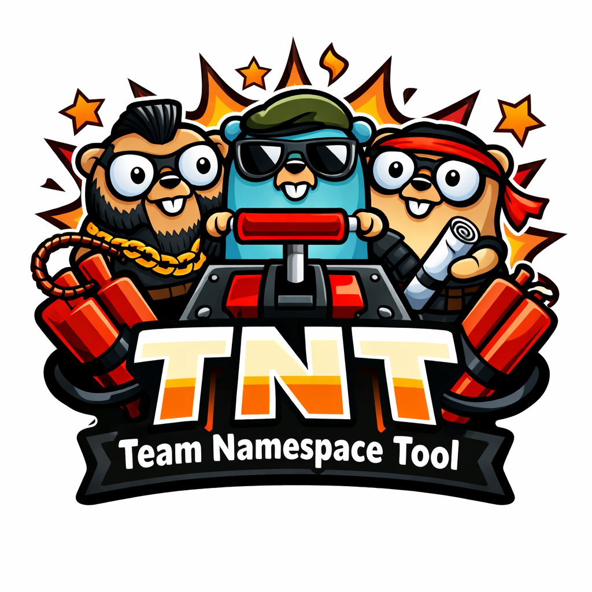

# My Presentation

A simple subtitle for the presentation.

This is a second subtitle sentence.

## Introduction

Welcome to the presentation.

- First point
- Second point

## A Table
| Name | Language | Year |
|---|---|---:|
| Go | Go | 2009 |
| Python | Python | 1991 |

## Code Example

Here is some Go code:

```go
package main

import "fmt"

func main() {
    fmt.Println("Hello, slides!")
}
```

:notes-start
* These are the presenter notes - only shown on the presenter view
* Simple hello world
* Only uses std-lib
* Can be compiled to **fully self-contained** binary
:notes-end

## Picture Example



## Conclusion

Thanks for watching!